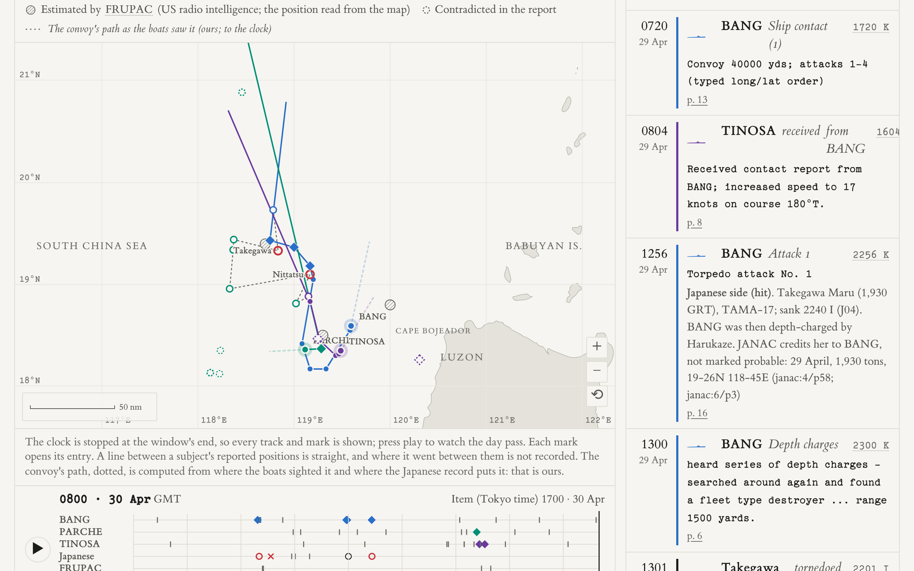

# WWII research kit

[](https://erichutchins.github.io/wwii-research-kit/)
[](https://github.com/erichutchins/wwii-research-kit/actions/workflows/pages.yml)
[](https://claude.com/claude-code)
[](LICENSE)
[](https://github.com/erichutchins/wwii-unit-records/blob/main/LICENSE)

**Where was a ship or a unit of the Second World War, day by day? What did the other side write down about the same
hours?** This kit finds the records each kept at the time, reads them, and charts them: on maps and timelines, every
mark with the scanned page it was read from. It charts the history; it does not set out to interpret it.

Three names, three things: the **WWII research kit** (this repository: the tools and guides), the
[**WWII unit records**](https://github.com/erichutchins/wwii-unit-records) (the transcriptions, as data), and
[***Charting WWII History***](https://erichutchins.github.io/wwii-research-kit/), the site that puts the two together.

[](https://erichutchins.github.io/wwii-research-kit/engagement.html?e=tama-17-1944-04-29)

*Convoy TAMA-17 west of Luzon, 29–30 April 1944: three submarines' war patrol reports, the Japanese record of the
two ships sunk, and US radio intelligence's estimates, on one map and one GMT clock. Each mark opens its page.*

**[Open *Charting WWII History*](https://erichutchins.github.io/wwii-research-kit/)** ·
[About, method and limits](https://erichutchins.github.io/wwii-research-kit/about.html) ·
[Researching a relative](https://erichutchins.github.io/wwii-research-kit/relatives.html) ·
[The data](https://github.com/erichutchins/wwii-unit-records) ·
[The guides](guides/README.md)

## What you can do with it

- **Follow a ship or unit.** A submarine's six war patrols position by position, a destroyer's war diary, an
  anti-aircraft battery's stations from its morning reports, a Seabee battalion from its muster rolls.
- **Read an engagement from both sides.** A convoy battle from the submarines' reports and the escorts' diaries; a
  kamikaze attack from the destroyer's action report and the air group's records; five minutes over Bavaria from
  three records that never mention each other.
- **Decode the records' notations.** The Imperial Navy's kana position grid, the Kriegsmarine's naval squares, the
  German Army's reference points, six US Army map grids, zone-lettered times, a torpedo attack data sheet.
- **Do it for your own ship or unit.** The tools find and download the scans, check a transcription by arithmetic,
  and build the pages. The guides say how each archive works.

## The sources, and how to read them

Most of what the kit does is reading. Each kind of record has a guide that says where it is held, how to get at it
without a reading room, how it is laid out, and where it misleads. All of these are free to read online.

| The record | What it gives you | Where it is | The guide |
|---|---|---|---|
| **US submarine war patrol reports** | Every position, contact, attack and dive of a patrol, with the attack data sheets | National Archives catalog, Record Group 38, [series 305243](https://catalog.archives.gov/id/305243) | [METHODS](guides/METHODS.md) |
| **Ships' and commands' war diaries** | A ship's day: positions at 0800, 1200 and 2000, her task group, what she did | National Archives catalog, RG 38, [series 4697018](https://catalog.archives.gov/id/4697018) | [METHODS](guides/METHODS.md) |
| **Army morning reports** | A company's or battery's station on every day it moved, 1940–1944 | National Archives catalog, RG 64, [series 85713825](https://catalog.archives.gov/id/85713825): microfilm rolls with searchable text | [MORNING-REPORTS](guides/MORNING-REPORTS.md) |
| **Navy muster rolls** | A shore unit, such as a Seabee battalion, through its men's transfers | National Archives catalog, RG 24, [series 594996](https://catalog.archives.gov/id/594996) | [MUSTER-ROLLS](guides/MUSTER-ROLLS.md) |
| **Imperial Japanese Navy records** | The target's own account: escort commands' war diaries, battle reports, telegram logs, and the movement tables of navy-controlled merchant ships | [JACAR](https://www.jacar.archives.go.jp/), the Japan Center for Asian Historical Records | [JAPANESE-RECORDS](guides/JAPANESE-RECORDS.md) |
| **FRUPAC war maps** | US radio intelligence's picture of the same day: where Fleet Radio Unit, Pacific placed Japanese convoys and ships | [Portal to Texas History](https://texashistory.unt.edu/explore/collections/FRUPAC/) (linked, never copied) | [JAPANESE-RECORDS](guides/JAPANESE-RECORDS.md) |
| **German army and navy records** | Corps and army war diaries and their daily reports in Italy; the Naval Staff's operation charts | National Archives microfilm [T-312](https://catalog.archives.gov/id/12007587), [T-314](https://catalog.archives.gov/id/12004195) and T-1022, RG 242 | [BEZUGSPUNKTE](guides/BEZUGSPUNKTE.md), [NAVAL-GRID](guides/NAVAL-GRID.md) |
| **Twelfth Army Group situation maps** | The front and every division on it, one sheet a day from 6 June 1944 | [Library of Congress](https://www.loc.gov/collections/world-war-ii-maps-military-situation-maps-from-1944-to-1945/), any region of any sheet by IIIF | [SITUATION-MAPS](guides/SITUATION-MAPS.md) |
| **Unit histories and after action reports** | What a unit wrote about itself, where the daily records stop | Google Books in full view; division museums' collections | [GOOGLEBOOKS](guides/GOOGLEBOOKS.md) |

The bibliography, with every source's holder, terms and citation form, is
[`records/SOURCES.yml`](https://github.com/erichutchins/wwii-unit-records/blob/main/SOURCES.yml).

### Worked out along the way

Some of the records could not be placed on a map until their notation was understood. These are the parts of the kit
most likely to help someone else, and each says plainly what is established, what is probable and what is still open.

- **The Imperial Navy's kana position codes** (「メキ三ツ」). No code table has been found. The keys for October 1944
  and April 1945 are rebuilt letter by letter from positions known some other way: an air group's own track charts, a
  conversion printed in the official war history, an order of May 1942.
  [JAPANESE-GRID](guides/JAPANESE-GRID.md), `tools/jgrid.py`.
- **The German Army's reference points in Italy** ("XXIII 68" is Caira, north of Cassino). Tenth Army's reports give
  places as a block and a point number on a secret overlay map. Three editions of that map are on the microfilm, and
  their points are keyed from it. [BEZUGSPUNKTE](guides/BEZUGSPUNKTE.md), `tools/bezugspunkt.py`.
- **The Kriegsmarine's naval squares in the Mediterranean** ("CJ 9472"), read off the Naval Staff's wartime charts
  and tested against places the war diary names. [NAVAL-GRID](guides/NAVAL-GRID.md), `tools/naval_grid.py`.
- **Finding the Japanese record of a US attack.** Which command's diary holds it, why a ship is filed under the
  command that received her signal, why a daily summary's silence proves nothing, and how a time in Tokyo's zone
  meets one in the submarine's. [JAPANESE-RECORDS](guides/JAPANESE-RECORDS.md).
- **Reading a morning report roll without a reading room.** The catalog's text search finds a unit's pages among
  thousands; the station is then read on the scan. [MORNING-REPORTS](guides/MORNING-REPORTS.md),
  `tools/morning_reports.py`.
- **A front line from a scanned map.** A sheet is fitted to the ground by its towns, the front traced by its ticked
  stretches, and the unit symbols read as drawn. [SITUATION-MAPS](guides/SITUATION-MAPS.md).

The site's explainers show the same things worked through on real entries:
[time zones](https://erichutchins.github.io/wwii-research-kit/zones.html),
[the US Army's map grids](https://erichutchins.github.io/wwii-research-kit/grids.html),
[the Japanese grid](https://erichutchins.github.io/wwii-research-kit/jgrid.html),
[the German grids](https://erichutchins.github.io/wwii-research-kit/german.html),
[torpedo fire control](https://erichutchins.github.io/wwii-research-kit/torpedo.html),
[the Torpedo Data Computer](https://erichutchins.github.io/wwii-research-kit/tdc.html) and
[depth charges](https://erichutchins.github.io/wwii-research-kit/depthcharge.html).

## Made with Claude

Claude, Anthropic's AI model, did the reading. Working in [Claude Code](https://claude.com/claude-code) under the
rules below, it found the records, read every scanned page, transcribed the values, translated the Japanese, German,
French and Italian, worked out the conversions and placements, and wrote the tools and the pages. One researcher
chose what to follow, set the rules, reviewed the results and decided what to publish.

So the kit is built to be checked, not believed. A typed value stands on its citation: one click shows the scan. A
translation, a computed position or a ranking of explanations is the kit's own work and is labelled derived,
inferred or assumed. No row has had an independent second reading yet. `CLAUDE.md` and `.claude/skills/` are the
instructions Claude works from, and they are part of the method: read them as you would a lab protocol.

## What it covers

The records read so far are US submarine war patrol reports, ships' war diaries and action reports, Army morning
reports and unit histories, Navy muster rolls and Twelfth Army Group's daily situation maps; and, for the other side,
the Imperial Japanese Navy's war diaries and escort reports (through JACAR) and German corps, army and naval staff
records (National Archives microfilm). The transcriptions are a separate repository,
[wwii-unit-records](https://github.com/erichutchins/wwii-unit-records), held here as `records/`:

| | |
|---|---|
| <!--n:boats-->26<!--/n--> submarines | USS BANG (SS-385) for all six war patrols; the others for one or two patrols each |
| <!--n:ships-->23<!--/n--> surface ships | four at length from their war diaries, the rest for one day |
| <!--n:army_units-->33<!--/n--> Army units | mostly anti-aircraft artillery, station by station |
| <!--n:battalions-->2<!--/n--> naval construction battalions | from their muster rolls |
| <!--n:convoys-->12<!--/n--> Japanese convoys, <!--n:other_ships-->1<!--/n--> Japanese escort followed through her own diaries, <!--n:engagements-->26<!--/n--> engagements | the other side's own record is entered for <!--n:engagements_other_side-->22<!--/n--> of the engagements; each page says which |
| The front in Europe | the daily situation maps from 6 June 1944 |

The selection is not a sample of the war. It began with one submarine and grew along one family's research: the
units its members served in, those beside them and those that met them. The records name units and ships, never
those people. `records/inventory.yml` lists every report looked for, found or not. The numbers above are counted from the records
by `tools/readme_counts.py`, and the build check fails if they drift.

## The rules

1. **Cite every source.** Every value carries the page it was read from, in a short form listed in
   `records/SOURCES.yml`: `rg38-74802746/p05` is National Archives Record Group 38, catalog item 74802746, page 5.
   `tools/check_sources.py` fails on a citation that doesn't resolve, a row without one, and a record group that
   disagrees with the catalog's.
2. **Record what was typed.** Values are read on the scan image, never taken from text recognition, and recorded
   exactly as typed. A correction goes beside the typed value with its reason, never over it.
3. **Label what isn't reported.** Every value is reported, derived, inferred or assumed, in the data and on the page.
4. **Name the limits.** Claude read these pages once; there has been no independent second reading, and no
   translator has checked the translations. Absence from the records searched is not evidence of absence.

## What's here

| Folder | What |
|---|---|
| `site/` | The pages: static HTML and D3, no build step |
| `guides/` | How each archive works and how its records are read; start at [guides/README.md](guides/README.md) |
| `tools/` | Python: find and download records, crop scans for reading, check transcriptions, build the pages' data ([tools/README.md](tools/README.md)) |
| `reference/` | The Japanese kana grid keys, the German grids' keys, the convoy lanes and the glossary |
| `records/` | The data: the wwii-unit-records repository, a submodule, with its own [README](records/README.md) |
| `CLAUDE.md`, `.claude/` | The rules and step-by-step workflows an AI agent follows here |

## Run it

```bash
git clone --recurse-submodules https://github.com/erichutchins/wwii-research-kit.git
cd wwii-research-kit
python3 tools/serve.py        # then open http://localhost:8385/site/
```

Viewing needs nothing else. The tools need Python 3.9 or later and run with [uv](https://docs.astral.sh/uv/), which
fetches what each one imports. Scans are never committed: they download to `sources/` (git-ignored), and the pages
fall back to the archive's own copy.

```bash
python3 tools/nara.py find "Wahoo"                  # a submarine's war patrol report folders
python3 tools/nara.py fetch 74802746                # its scans -> sources/nara/rg38-74802746/
uv run tools/crop_pages.py halves 74802746 03 04    # readable halves
uv run tools/check_track.py bang/1                  # speed-check a transcribed patrol
uv run tools/check_sources.py                       # every citation resolves
python3 tools/morning_reports.py unit 578447414 'Btry.{0,4}D.{0,6}62'   # a unit's morning reports
python3 tools/jacar.py search "日達丸"               # Japanese records
python3 tools/jgrid.py decode メキ三ツ               # a Japanese kana position code
python3 tools/grid_ref.py lambert2 J-762365         # an Army grid reference -> latitude and longitude
```

To work on your own ship or unit, point the tools at your own records folder with `WWII_RECORDS=/path/to/records`.
[Researching a relative](https://erichutchins.github.io/wwii-research-kit/relatives.html) says where to start.

## Corrections and contributions

Corrections are welcome as issues on the [records](https://github.com/erichutchins/wwii-unit-records/issues): which
mark, and what the page says instead. A transcription of another ship or unit is welcome as a pull request there.
The kit and its data are two repositories, so a change to the records is committed and pushed in `records/` first
and the kit then records the new version; `CLAUDE.md` has the checks that run before a commit and a push.

## Licence and citation

Code: MIT. The records: CC BY 4.0 (`records/LICENSE`). The original records keep their own terms, listed source by
source in `records/SOURCES.yml`. Cite the original record for any value you use. To cite the kit or the
transcription:

> Eric Hutchins, with Claude (Anthropic), *Charting WWII History* (site, built with the WWII research kit from the
> WWII unit records), https://erichutchins.github.io/wwii-research-kit/, version of `<the date at the foot of the
> site's pages>`.
